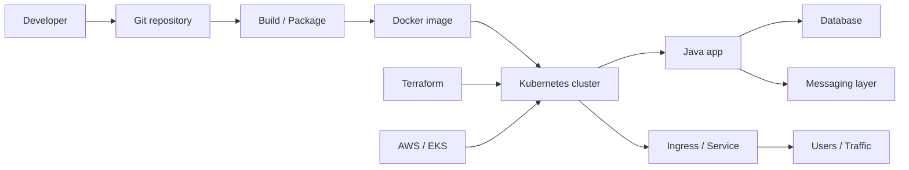
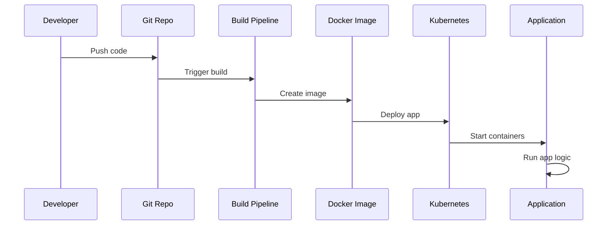

# Java & DevOps Portfolio – VProfile Cloud Demo

A practical, hands-on project that shows how a Java application can be built, containerized, deployed, and run in a cloud-native environment.

This repo is meant to feel like a real-world learning project: a Java backend, Docker packaging, Kubernetes deployment, and infrastructure automation in one place.

## 🚀 What this project demonstrates

This repository brings together the pieces of a modern cloud app:

- Java backend development with Spring MVC, Spring Security, and JPA
- Packaging with Maven and Docker
- Deployment with Kubernetes and Helm
- Cloud infrastructure with Terraform
- AWS/EKS-style architecture patterns
- A realistic DevOps workflow for application delivery

## 🧭 Project overview

The idea is simple: take a Java web application and make it run like a real production service in a modern cloud setup.

This project is useful for learning how the pieces fit together:

- code is written in Java
- it is packaged into a container
- the container is deployed to Kubernetes
- infrastructure is defined as code
- environment values and secrets stay outside the repo

## 🏗️ Architecture at a glance

## 🗺️ Repository structure

- `vprofile-app/` – Java application source, config, and app packaging
- `vprofile-helm/` – Helm charts for Kubernetes deployment
- `vprofile-infra/` – Terraform for cloud infrastructure
- `README.md` – project overview and setup notes

## 🧩 What is inside each part?

### `vprofile-app/`
This is the application layer. It contains the Java backend logic, configuration files, and packaging setup needed to run the service.

### `vprofile-helm/`
This is the deployment layer. Helm helps define how the app is deployed into Kubernetes, including services, ingress, and config resources.

### `vprofile-infra/`
This is the cloud layer. Terraform files describe infrastructure such as networking, compute, and Kubernetes-related resources.

## 🛠️ Tech stack

- Java 17+
- Spring MVC
- Spring Security
- JPA / database integration
- Maven
- Docker
- Kubernetes
- Helm
- Terraform
- AWS / EKS
- Git and GitHub-based workflows

## 🔄 Typical workflow

## 📌 Why this project is useful

This project is a good example of how real applications are moved from local development into cloud deployment:

- you can see how Java apps are structured
- you can understand what Docker and Kubernetes do in practice
- you can learn how infrastructure is described with Terraform
- you can practice end-to-end delivery in a cloud-native setup

It is less about a single feature and more about understanding the full app lifecycle.

## 🚀 Local setup

1. Open the project folder you want to work with.
2. Review the Java application configuration and deployment files.
3. Adjust values for your own environment and infrastructure.
4. Build and run the app locally or package it for container deployment.
5. Use the Helm and Terraform folders to extend deployment scenarios.

## 🔐 Security notes

This repository is intentionally prepared for public sharing and does not include:

- AWS keys
- database passwords
- private SSH keys
- Terraform state files
- local environment files

In a real project, secrets should be managed through:

- GitHub Secrets
- Kubernetes Secrets
- AWS Secrets Manager
- SSM Parameter Store
- environment variables managed outside the repo

## 🌱 Possible next steps

This is a very good base for extending the project with:

- CI/CD pipelines
- automated tests
- health checks and monitoring
- logging and observability
- additional microservices and service communication
- production-quality deployment patterns

## ✅ Summary

This project is a friendly, practical example of how Java, containers, Kubernetes, and cloud infrastructure fit together in a real DevOps workflow.

It is designed to help you understand the full picture, not just the code.

If you are learning Java + DevOps, this repo is a solid starting point for building a portfolio that looks real and demonstrates real-world thinking.
